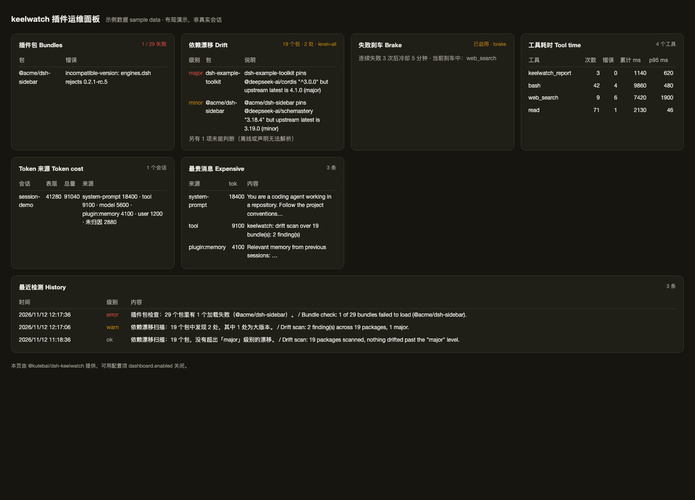

# dsh-keelwatch

English | [中文](README.zh.md)



> The image above uses the dashboard's sample-data mode (`?demo=1`) to show the layout; a live page shows your own sessions.

The **operations layer** for a DeepSeek Harness (DSH) plugin ecosystem. Once you install a dozen plugins, you need something that watches *them*. keelwatch adds no agent capability — it fixes three concrete problems:

| Problem | What you see | What keelwatch does |
|:---|:---|:---|
| A plugin silently stops working | DSH starts fine, but a capability is gone | Reads every bundle's load result and reports the exact package that failed |
| Upstream moved, next reinstall breaks | Works today, breaks after an upgrade | Compares declared dependency ranges against the registry and grades the drift (major / minor / patch) |
| One broken tool gets retried forever | Tokens burn, turns get slow | Counts consecutive failures per tool, then denies further calls with a cause-specific next step (not just "no"). User cancellations are never counted |
| Token cost is a mystery | Big bills, no attribution | Attributes surface tokens per source (`user` / `model` / `tool` / `plugin:xxx`) and lists the most expensive individual messages |

## First, what is a bundle?

A DSH **profile** (`~/.dsh/profiles/<name>/`) is a composition of plugins. The unit you install is a **bundle**: one npm package plus a config patch (`cordis.patch.yml`) that inserts several plugin *rows* into your profile. So "a plugin is broken" can mean the package failed to load, or one row is misconfigured. The `bundles:` line in the report is the package layer; `row` is the config layer.

## Install

```sh
# 1) from npm (recommended: prebuilt, no build authorization)
dsh plugin --profile <profile> add @kutebai/dsh-keelwatch

# 1b) tarball from the GitHub release
dsh plugin --profile <profile> add ./kutebai-dsh-keelwatch-0.2.0.tgz

# 2) straight from the repository (build output is committed, no build授权 needed)
dsh plugin --profile <profile> add github:kute/dsh-keelwatch

# 3) local development (directory link; rebuild + restart after changes)
pnpm build
dsh plugin --profile <profile> add /path/to/dsh-keelwatch
```

**In the DSH plugin market**: there is no central index — add this URL under Plugins → Discover → Add index source:

```
https://kute.github.io/dsh-keelwatch/index.json
```

Requires `engines.dsh: >=0.2.1-0 <0.3.0-0` (covers DSH 0.2.1.x / 0.2.2.x), Node `>=22.19`, all platforms.

## Configuration

Two ways, same result:

1. **Web GUI** — Plugins → `@kutebai/dsh-keelwatch` → the configuration section. Saving validates the values, writes only this plugin's row into the profile patch (after backing the file up), and lets the Loader reload it.
2. **YAML** — edit `~/.dsh/profiles/<profile>/cordis.patch.yml` directly.

```yaml
- id: keelwatch
  config:
    driftRadar:
      enabled: true
      checkIntervalHours: 24     # 0 = scan at startup only
      alertLevel: major          # major | minor | all
      whitelist: []
      registryUrl: ''            # empty = the configured npm registry
      requestTimeoutMs: 8000
    failureBrake:
      enabled: false             # off by default: record only
      action: log                # log | brake
      maxConsecutiveErrors: 5
      cooldownMinutes: 10
      tools: []
      exclude: []
      neverBrake: [ask_user_question]
    costAttribution:
      enabled: true
      retentionDays: 7
      topN: 10
      toolToBundle: {}
    dashboard:
      enabled: false        # opt-in: serves /keelwatch/dashboard
      refreshSeconds: 30    # 10-600
```

## Dashboard (opt-in, off by default)

Turn it on in the plugin config page, or in YAML:

```yaml
dashboard:
  enabled: true       # default false
  refreshSeconds: 30  # 10–600
```

Turn it on and a **"open dashboard ↗"** link appears in the plugin's Dashboard card (it carries the GUI token). Or open `/keelwatch/dashboard?token=<GUI token>` directly — the page is standalone, not a section in the sidebar.

The page shows bundle health, dependency drift with fix suggestions, brake state, per-tool latency (calls/errors/total/p95), token cost by source with the most expensive messages, a **7-day detection trend**, and recent history.

Both routes verify the GUI token (query parameter, `x-dsh-token` header, or `dsh_token` cookie) because the host's `/api` fence does not cover custom paths; anything else gets 401. It is plain HTML — no client build, no dependency on the client plugin loading — and turning the switch off unregisters both routes.

## How detection runs

| Check | When |
|:---|:---|
| Bundle health (any failed load?) | 5 s after startup, then on every `checkIntervalHours` |
| Dependency drift | At startup, then every `checkIntervalHours` |
| Failure brake | Real time: counted after each call, enforced before the next |
| Token / latency | Accumulated in real time, summarised on demand |

`checkIntervalHours` (default 24, `0` = startup only) is the single frequency knob.

## How you get told

1. **Logs** — serious findings also go to `stderr` (e.g. `~/Library/Logs/dsh-web.err.log`), so they survive without opening a session.
2. **Plugin page** — a *recent detections* list with time, level, and a bilingual line per entry.
3. **Chat** — `keelwatch_report` for the full report plus a conclusion.

It never injects monitoring noise into your conversation: push costs context, pull is cleaner.

## Where the history lives

| Where | What |
|:---|:---|
| Plugin page → recent detections | Last 20 entries: time, level, ZH + EN |
| `~/.dsh/keelwatch/history.jsonl` | Raw records (`kind`/`level`/`en`/`zh`/`detail`/`at`) |
| `GET /keelwatch/history?limit=50` | Same data over HTTP (needs the GUI token) |

Pruned by `costAttribution.retentionDays` (default 7) and capped at 500 entries.

## The report

```
keelwatch_report                                    # status (default)
keelwatch_report action=disable bundle=<pkg name>   # turn off a broken bundle
```

Every section carries an `EN:` and a `ZH:` reading, and the report ends with a single `Conclusion` that tells you whether to act:

```
[1] Bundles 插件包            29 tracked, no load errors
[2] Dependency drift 依赖漂移 19 scanned, 2 findings (minor)
[3] Failure brake 失败刹车    disabled in configuration
[4] Tool time 工具耗时        per tool: calls, errors, total, p95
[5] Tokens 上下文成本          surface / total per session, by source kind
[6] Conclusion 结论           nothing to fix today
```

Notes on reading it:

- `bundles` is the package layer (including shipped-but-disabled bundles); `drift` scans packages whose `package.json` is actually on disk, so the counts differ.
- `no findings` with `alertLevel: major` only means nobody crossed a major boundary — set `all` to see minors.
- `unattributed` tokens are messages that predate keelwatch: attribution starts recording when the plugin loads, and the host offers no supported way to read history events retroactively.

## What it deliberately does not do

No timeouts (the host's `dsh-tool-call-timeout-policy` owns them), no repeat-call reminders (the host's `dsh-repeat-tool-reminder` owns them), no killing in-flight calls (DSH cancellation is cooperative), no source modification, no replacement of the tool executor, no separate web UI, no health grades.

## Attribution accuracy

| Dimension | Accuracy |
|:---|:---|
| Session total, context pressure | Exact (host `ctx.tokenMeter`) |
| Tokens per message source kind | Exact for events observed after keelwatch loaded |
| Per-tool latency and error rate | Exact |
| Attribution to an npm package | Inferred: exact only when a plugin declares its own `MessageSource.kind` |

## Development

```sh
pnpm install
pnpm build      # tsc -> lib/ ; browser half src/client/index.js -> lib/client.js
pnpm test       # node --test test/*.test.mjs
pnpm market     # regenerate site/index.json (plugin market index)
```

Verification and rollback: [VERIFY.md](VERIFY.md), [scripts/rollback.sh](scripts/rollback.sh).

## License

MIT
