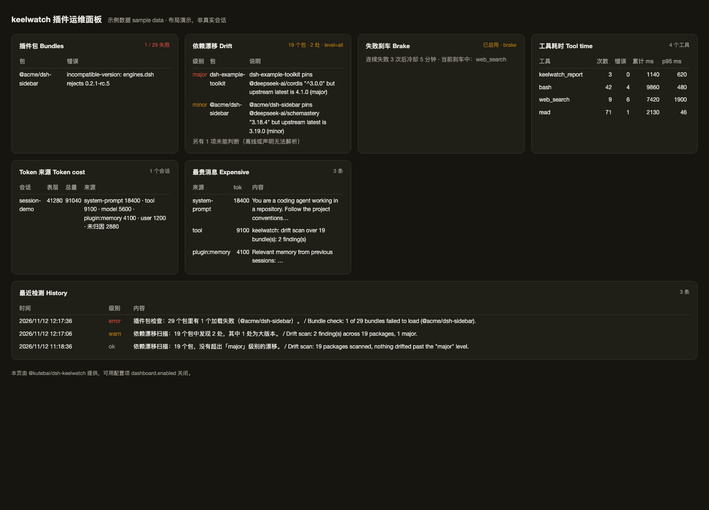

# dsh-keelwatch

[English](README.md) | 中文

给 DeepSeek Harness（DSH）装了很多插件之后，你需要一个**看住这些插件的东西**。keelwatch 就是它。



> 上图是`/keelwatch/dashboard` 的示例数据模式（`?demo=1`），用于展示布局；真实页面显示你自己的会话数据。

它不给你新功能，只解决三个具体麻烦：**插件哪天突然坏了没人告诉你**、**一个工具反复失败把会话拖垮**、**不知道谁在吃 Token 和时间**。

---

## 一、先搞清楚几个词（30 秒）

| 词 | 是什么 | 类比 |
|:---|:---|:---|
| **profile** | 一套插件组合及其配置，放在 `~/.dsh/profiles/<名字>/`。你日常启动的 GUI 用的是 `web` profile | 一份"已经装好并调好的软件清单" |
| **bundle（组合包）** | DSH 插件的分发单位 = **一个 npm 包 + 一份配置补丁**（`cordis.patch.yml`）。安装一个 bundle，它会往 profile 里插入若干"插件行"并给默认配置 | 一个"安装包"，里面可能带好几个零件 |
| **插件行 / row** | 配置里的一行：`- id: keelwatch` + 用哪个包 + 什么配置 | 清单上的一行，可以单独开关 |
| **工具 / tool** | 模型能调用的动作，比如 `bash`、`read`、`web_search` | 模型的手 |
| **上下文 / token** | 每次请求都要把历史消息和插件注入的内容重新发给模型，这些内容按 token 计费 | 每次开会都要把全部资料再念一遍，念得越多越贵 |

**为什么要懂 bundle**：装一个插件其实是装了一个包，包里可能包含多个插件行。所以"插件坏了"可能坏在包（加载失败）或行（配置不对）。keelwatch 的"插件包健康"检查的是**包这一层**，报告里 `bundles: 29 tracked` 说的就是包的数量。

---

## 二、它到底解决什么问题

### 问题 1：某天 DSH 打不开，或者某个能力突然没了

**现象**：昨天还好好的，今天启动报错；或者界面能开但某个功能不见了。

**原因**：某个 bundle 声明的版本范围（`engines.dsh` / 依赖版本）在你升级 DSH 或重装插件后不再成立。DSH 会把这一行**跳过**——它不会大喊大叫，只是那个能力悄悄消失。

**keelwatch 做什么**：

- 启动时读一遍 profile 里所有 bundle 的清单，**哪个包没加载成功，直接报出来**（含错误码）；
- 每条漂移都带**修复建议**（只给文本、不擅自改文件）：例如 `pin it back with "@deepseek-ai/*": "3.18.4"`，或"升级该包 / 用 `keelwatch_report action=disable` 关掉它"；
- 定期比对"包声明的依赖范围"和"上游 registry 上的最新版本"，判断上游跑了多远：
  - `major` = 上游出了大版本，**下次重装会拿到不兼容的版本**
  - `minor` = 上游出了新小版本，今天没事，下次重装可能会踩到
- 报告里能给出**确切的包名**，并支持用工具把它一键关掉（关掉需重启才彻底生效，报告会如实说明）。

一句话：**把"悄悄消失的能力"变成"一条带包名的告警"**。

### 问题 2：一个工具坏了，模型一次次重试，越试越慢越贵

**现象**：某个命令老是失败，模型换个参数再试、再试，一轮对话烧掉几万 token，还卡很久。

**原因**：DSH 已经保证"工具报错不会终止对话"，但没保证"模型不会一直重试"。官方有单次超时（`tool-call-timeout-policy`），也有"同参数重复调用提醒"（`repeat-tool-reminder`），但**连续失败后的刹车**没有人做。

**keelwatch 做什么**：给每个工具记连续失败次数。

- 默认只记录（`action: log`），不干预；
- 你确认安全后改成 `brake`：连续失败 N 次后，这个工具进入冷却 T 分钟，期间调用直接被拒，模型会收到一句明确的话：

  > `keelwatch: bash failed 5 times in a row and is cooling down for 5 minute(s). Do not retry it; use another tool or tell the user.`

- 冷却结束后放行**一次**探测：成功就恢复正常，失败就再冷却一轮。

拦截时除了说明原因，还会给出**下一步建议**（按最后一次错误码：路径不存在就提示先确认路径、超时就提示缩小范围或换更快的工具……），而不是只回一句"不许调用"。它不杀正在跑的调用、不改参数、不影响其他工具和会话本身；**你自己取消的调用不算失败**，不会误伤健康工具。

### 问题 3：Token 花得快、对话变慢，不知道是谁干的

**现象**：装了十来个插件，聊几轮就花了十几万 token；或者某个操作特别慢但看不出是哪一步。

**原因**：插件会往上下文里注入内容（记忆、检索结果、提示词、目录清单……），每条都要重复计费；工具调用耗时也没有分项统计。

**keelwatch 做什么**：

- 记下每条进入上下文的消息**由谁产生**（`user` / `model` / `tool` / `plugin:xxx`），再和官方 `tokenMeter` 的每条消息价格对上，**按来源统计 Token**，并列出**最贵的单条消息**（带 100 字预览）；
- 在工具执行层计时，按工具名给出调用次数、错误数、累计耗时、p95。

一句话：**把"总量"拆成"谁贡献的"**。

---

## 三、装好之后怎么用

### 配置页（Web GUI）

侧栏 **插件** → `@kutebai/dsh-keelwatch` → 详情页里的**配置区**。改完点保存即可，会：

1. 校验（非法值不会落盘）；
2. 写入 `~/.dsh/profiles/<profile>/cordis.patch.yml` 里属于本插件的那一行（整行 `config` 替换）；
3. 先备份原文件（`cordis.patch.yml.bak-<时间戳>`）；
4. 交给 Loader 重载该行，新配置生效（没生效就重启一次）。

### 命令行 / 让模型调用

```
keelwatch_report              # 默认，输出状态报告
keelwatch_report action=disable bundle=<包名>   # 关掉加载失败的包
```

报告每段都有 **EN / ZH 解读**，最后给一条 **结论**，告诉你要不要动手。

---

## 三点五、网页仪表盘（可选，默认关闭）

配置页最下面有 **「网页仪表盘（Dashboard）」** 开关，或直接改 YAML：

```yaml
dashboard:
  enabled: true      # 默认 false
  refreshSeconds: 30 # 页面自动刷新间隔（10–600）
```

开启后访问（要带 GUI 的 token，和打开界面用的是同一个）：

```
http://127.0.0.1:3080/keelwatch/dashboard?token=<你的 GUI token>
```

一页看完七块：插件包健康、依赖漂移（含修复建议）、刹车状态、工具耗时（次数/错误/累计/p95）、Token 来源（含**最贵的单条消息**）、**近 7 天检测趋势**、最近检测记录。页面是纯 HTML，不依赖前端构建，也不会因为客户端插件加载失败而白屏；关掉开关后两个路由都不再注册。

**从哪里进**：仪表盘是独立页面，不在侧栏里。开关打开后，插件配置页的 Dashboard 卡片会多出一个 **「打开仪表盘 ↗」** 链接（自动带上当前 GUI token），点它即可。也可以手工打开 `/keelwatch/dashboard?token=<GUI token>`。

**访问控制**：这两个路由用 GUI 的 token 校验（查询参数、`x-dsh-token` 头或 `dsh_token` cookie 之一），因为 DSH 的 `/api` 防护不覆盖自定义路径。没有 token 一律 401。

## 三点六、它是怎么工作的（检测频率 / 通知 / 历史）

### 检测跑在什么节奏上

| 检测 | 什么时候跑 | 依据 |
|:---|:---|:---|
| **插件包健康**（有没有包加载失败） | 启动后 5 秒跑一次（等 Loader 稳定），之后每「扫描间隔」跑一次 | `driftRadar.checkIntervalHours` |
| **依赖漂移**（上游版本/Range） | 启动时一次，之后每「扫描间隔」一次 | `driftRadar.checkIntervalHours` |
| **失败刹车** | 实时，每次工具调用后计数、调用前判断 | 每次 `tools/execute` |
| **Token / 耗时** | 实时累积，报告时汇总 | 每次请求 / 每次工具调用 |

所以只有一个频率旋钮：**扫描间隔**（默认 24 小时，`0` = 只在启动时扫）。刹车和成本统计是实时行为，不受它影响。

### 发现问题怎么通知你

三层，从"一定会写"到"你自己查"：

1. **日志**：加载失败等严重问题除了宿主日志，还会写 `stderr`，直接进 `~/Library/Logs/dsh-web.err.log`（macOS）。这是你排障时最可靠的一层。
2. **配置页**：插件详情页里有**最近检测记录**（见下），中英对照，带时间与级别。
3. **对话**：让模型调 `keelwatch_report`，拿完整报告 + 结论。

**刻意不做的事**：不往你的会话里插话。监控信息混进对话会污染上下文、也会出现在历史里；需要时用工具取，比每条都推送更干净。

### 历史报告在哪看

| 位置 | 内容 |
|:---|:---|
| **配置页 → 最近检测记录** | 最近 20 条，时间 / 级别（正常·提示·注意·故障）/ 中文摘要 + 英文一行 |
| **网页仪表盘**（需开启） | `/keelwatch/dashboard`，六块聚合 + 30 秒自动刷新；`?demo=1` 为示例数据 |
| `~/.dsh/keelwatch/history.jsonl` | 原始记录，一行一条 JSON（`kind`/`level`/`en`/`zh`/`detail`/`at`） |
| `GET /keelwatch/history?limit=50` | 同上的 HTTP 形式（需要 GUI token） |

保留策略：按 `costAttribution.retentionDays`（默认 7 天）过滤，最多保留 500 条；读取时会顺带压缩文件，不会无限增长。

## 四、配置项逐个解释

### 漂移雷达（Drift Radar）— 依赖兼容性

| 键 | 默认 | 意思 |
|:---|:---|:---|
| `enabled` | `true` | 总开关 |
| `checkIntervalHours` | `24` | 多久扫一次；`0` = 只在启动时扫 |
| `alertLevel` | `major` | `major` 只报大版本越界；`minor` 加小版本；`all` 全报。**想看全貌就填 `all`** |
| `whitelist` | `[]` | 不想被扫的包名（支持 `*`） |
| `registryUrl` | `''` | 空 = 用当前 npm registry；要指定镜像才填 |
| `requestTimeoutMs` | `8000` | 查 registry 的超时 |

### 失败刹车（Failure Brake）

| 键 | 默认 | 意思 |
|:---|:---|:---|
| `enabled` | `false` | 总开关，默认不干扰 |
| `action` | `log` | `log` 只记录；`brake` 冷却期内拒绝调用 |
| `maxConsecutiveErrors` | `5` | 连续失败几次触发（2–100） |
| `cooldownMinutes` | `10` | 冷却多久（1–1440） |
| `tools` | `[]` | 只对这些工具生效（空 = 全部） |
| `exclude` | `[]` | 排除的工具名（支持 `*`） |
| `neverBrake` | `["ask_user_question"]` | 永不拦截（人工交互工具） |

### 成本归因（Cost Attribution）

| 键 | 默认 | 意思 |
|:---|:---|:---|
| `enabled` | `true` | 是否记录耗时与 Token 归因 |
| `retentionDays` | `7` | 本地记录保留天数 |
| `topN` | `10` | 报告每张表显示几条 |
| `toolToBundle` | `{}` | 工具名 → 包名的人工映射（推断"哪个插件的工具"用） |

### 网页仪表盘（Dashboard）

| 键 | 默认 | 意思 |
|:---|:---|:---|
| `enabled` | `false` | 是否注册 `/keelwatch/dashboard` 与 `/keelwatch/status` 两个路由 |
| `refreshSeconds` | `30` | 页面自动刷新间隔（钳制 10–600） |

---

## 五、报告怎么读

```
keelwatch status report · keelwatch 状态报告
============================================

[1] Bundles 插件包
    29 bundle(s) tracked, no load errors 个插件包，无加载失败
    EN: All 29 bundles loaded; nothing is silently missing.
    ZH: 29 个插件包全部加载成功，没有悄悄缺失的能力。

[2] Dependency drift 依赖漂移
    19 package(s) scanned, 2 finding(s) 个包，2 处发现
    alertLevel=all · 告警级别
      - [minor] dsh-context-compression-improved pins @deepseek-ai/schemastery "3.18.4" but upstream latest is 3.19.0 (minor)
    EN: Nothing is broken today. The risk is deferred: the next reinstall or upgrade of these packages may pull a newer dependency than they were tested with.
    ZH: 今天不会坏，风险是延后的：这些包下次重装或升级时，可能拉到比它测试过的新依赖。

[3] Failure brake 失败刹车
    disabled in configuration · 配置中未启用
    EN: Repeating failures are neither counted nor blocked; every retry still reaches the tool.
    ZH: 未启用：连续失败既不统计也不拦截，模型每次重试都会真正打到工具。

[4] Tool time 工具耗时
    keelwatch: tool time (top 2)
      bash: 1 call(s), 0 error(s), total 254ms, p95 254ms
    EN: Slowest total time: bash (254ms across 1 call(s), p95 254ms).
    ZH: 累计耗时最高的是 bash（1 次共 254ms，p95 254ms）。

[5] Tokens 上下文成本
    session-…: 273713 surface / 387278 total over 636 node(s) — model 2208, tool 398, user 39, unattributed 269427
    EN: 273713 tokens are on the surface right now (what the next request pays); 269427 of them predate keelwatch and cannot be attributed.
    ZH: 当前表层 273713 token（= 下一次请求要付的上下文成本）；其中 269427 产生于 keelwatch 加载之前，无法归因。

[6] Conclusion 结论
    only minor drift, nothing to fix today · 仅有小版本漂移，今天无需处理
    EN: No action needed. Keep it in mind: the next reinstall of those packages will pick the newer dependency they were not tested against.
    ZH: 无需处理。记一笔即可：这些包下次重装会拿到它们没测试过的新依赖。
```

**每段的判断依据**：

| 段 | 数字从哪来 | 怎么用 |
|:---|:---|:---|
| Bundles | 插件管理服务的 bundle 清单 + 每条的 `error` | 有失败项 → 优先处理，可一键 disable |
| Drift | 每个已装包的 `engines.dsh` / 依赖范围 vs registry 最新版 | `major` 要动手；只有 `minor` 记一笔 |
| Brake | 内存状态机（落盘在 `$DSH_HOME/keelwatch/brake.json`） | 显示"正在刹车"时，说明有工具在冷却 |
| Tool time | 工具执行层计时 | `p95` 高而次数少 = 会卡；`calls` 多 = 用得多 |
| Tokens | 官方 `ctx.tokenMeter` + 消息来源 | `surface` 是"下一次要付的钱" |
| Conclusion | 以上五段的汇总判断 | 只看这一段也能决定动不动手 |

**关于 `unattributed`**：归因靠逐条记录"这条消息由谁产生"，而 keelwatch **只能记录它启动之后的消息**（官方已弃用回溯读取历史事件的接口）。所以老会话里历史消息都会落进 `unattributed`。**新开一个会话，这个数字会从接近 0 开始。**

---

## 六、安装

```sh
# 1) 从 npm（推荐，免构建授权）
dsh plugin --profile <profile> add @kutebai/dsh-keelwatch

# 1b) 从 GitHub Release 的 tarball（离线可用）
dsh plugin --profile <profile> add ./kutebai-dsh-keelwatch-0.2.0.tgz

# 2) 从仓库直装（产物已入库，安装时不跑构建脚本、无需授权）
dsh plugin --profile <profile> add github:kute/dsh-keelwatch

# 3) 本地开发（目录直链，改代码后 pnpm build + 重启即可）
pnpm build
dsh plugin --profile <profile> add /path/to/dsh-keelwatch
```

**在 DSH 插件市场里发现它**：DSH 没有中心市场，索引是托管在静态站的 JSON。打开 **插件 → 发现 → 添加索引源**，填入：

```
https://kute.github.io/dsh-keelwatch/index.json
```

之后就能在「发现」里看到 Keelwatch，并从索引指向的 commit 安装。

要求 `engines.dsh: >=0.2.1-0 <0.3.0-0`（覆盖 DSH 0.2.1.x / 0.2.2.x），Node `>=22.19`，全平台。

## 七、它不做什么

- **不做超时**：官方 `dsh-tool-call-timeout-policy` 已按工具声明的 `timeoutMs` 处理；
- **不做重复调用提醒**：官方 `dsh-repeat-tool-reminder` 已有；
- **不杀正在运行的调用**：DSH 的取消是协作式的，硬杀不存在；
- **不改插件源码、不替换工具执行器**；
- **不做独立前端页面、不打健康分**。

## 八、归因精度（别当账单用）

| 维度 | 精度 |
|:---|:---|
| 会话总量、上下文压力 | 精确（官方 `ctx.tokenMeter`） |
| 按消息来源 kind 的 Token | 精确（surface 节点价格 + `MessageSource.kind`），但只覆盖 keelwatch 启动后的事件 |
| 按工具的耗时与失败率 | 精确 |
| 按 npm 包归属 | **推断**：插件注入的消息若声明了自己的 source kind 才精确 |

## 九、开发

```sh
pnpm install
pnpm build      # tsc -> lib/ + 浏览器半侧 src/client/index.js -> lib/client.js
pnpm test       # node --test test/*.test.mjs
pnpm market     # 生成 site/index.json（插件市场索引）
```

验证与回滚手册见 [VERIFY.md](VERIFY.md)，回滚脚本见 [scripts/rollback.sh](scripts/rollback.sh)。

## 十、协议

MIT
